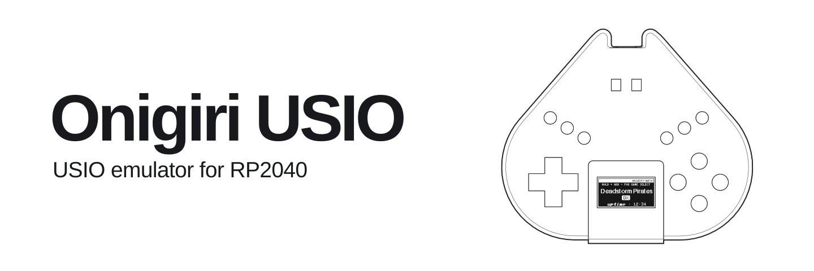

Firmware for the Onigiri controller (RP2040) that emulates the Namco USB I/O board for **System 357/369** arcade games. It replaces the Namco **USIO** board: coin, test/service,
player controls, gun aiming, card reader replies and 1 MiB of backup
memory, with a status display.

Supported games: Tekken 6, Tekken 6 Bloodline Rebellion, Tekken Tag
Tournament 2 (vanilla / Unlimited), Dragon Ball Zenkai Battle, Gundam Extreme
VS Maxi Boost, Razing Storm, Deadstorm Pirates, Dark Escape 4D, Sailor Zombie
AKB48, Taiko no Tatsujin. Hardware status per game is in
[docs/Games.md](docs/Games.md).

**User manuals**

[Italiano (PDF)](manual/Onigiri-USIO-IT.pdf) ? [English (PDF)](manual/Onigiri-USIO-EN.pdf)

**Download:** the ready-to-flash `.uf2` is on the
[Releases](https://github.com/danstronics/onigiri-usio/releases) page.

## What we learned about the USIO

* [docs/USIO-protocol.md](docs/USIO-protocol.md) - USB identity, command
  format, registers, input/status layout, backup memory.
* [docs/SDK-callback-race.md](docs/SDK-callback-race.md) - why emulated
  boards end in **NOT CONNECT IO-PCB** on every Namco SDK game, and how the
  firmware recovers the USB connection.
* [docs/Games.md](docs/Games.md) - per-game identity, node, switch bits,
  transport.
* [docs/Emulation-guide.md](docs/Emulation-guide.md) - checklist for
  writing your own emulator.
* [docs/Controls.md](docs/Controls.md) - button mapping and display.

## Building

Requirements: Raspberry Pi Pico SDK 2.2.0, CMake 3.20+, Ninja, the Arm GNU
toolchain. A host C compiler (GCC/MinGW) is needed for the tests.

```sh
# Firmware (2 MiB flash board)
cmake -S firmware -B build/rp2040 -G Ninja \
      -DPICO_SDK_PATH=/path/to/pico-sdk \
      -DPICO_BOARD=waveshare_rp2040_zero -DPICO_FLASH_SIZE_BYTES=2097152
cmake --build build/rp2040        # -> build/rp2040/Onigiri-USIO.uf2

# Host tests (protocol, transport with the real TinyUSB stack, flash, display)
cmake -S tests/usio -B build/host -G Ninja \
      -DUSIO_TINYUSB_PATH=/path/to/pico-sdk/lib/tinyusb
cmake --build build/host && ctest --test-dir build/host
```

To flash, hold BOOT, press RESET once, release BOOT and copy the `.uf2` to
the `RPI-RP2` drive (see the manual). The display font table is generated by
`tools/gen_fonts.py` (needs Pillow); the generated `firmware/ui_fonts.h` is
committed.

## Layout

```
firmware/         RP2040 firmware (protocol, USB transport, flash, UI)
libs/pico_ssd1306 SSD1306 driver (MIT) with bounded I2C writes
tests/usio        host tests: protocol, TinyUSB transport, flash, UI render
tests/ui          display preview renderer
manual/           Italian and English PDF manuals
tools/            OLED font generator
docs/             USIO documentation
```

## What is not included

No Sony system software, game files, dongle data, keys or Namco firmware
images. The identification bytes are protocol responses (from RPCS3), not a
dumped board firmware. Guns, wheels, motion, recoil and vital sensors are
not driven by real hardware.

## License

The firmware is GPL-2.0-only (it adapts RPCS3 code); see `COPYING` and
`NOTICE.md`. MIT notices for the iTaiko/DonCon2040 heritage (`LICENSE`),
pico_ssd1306 and the SDK components are kept. The title font is Aileron
(SIL Open Font License), see `NOTICE-fonts.md`.
