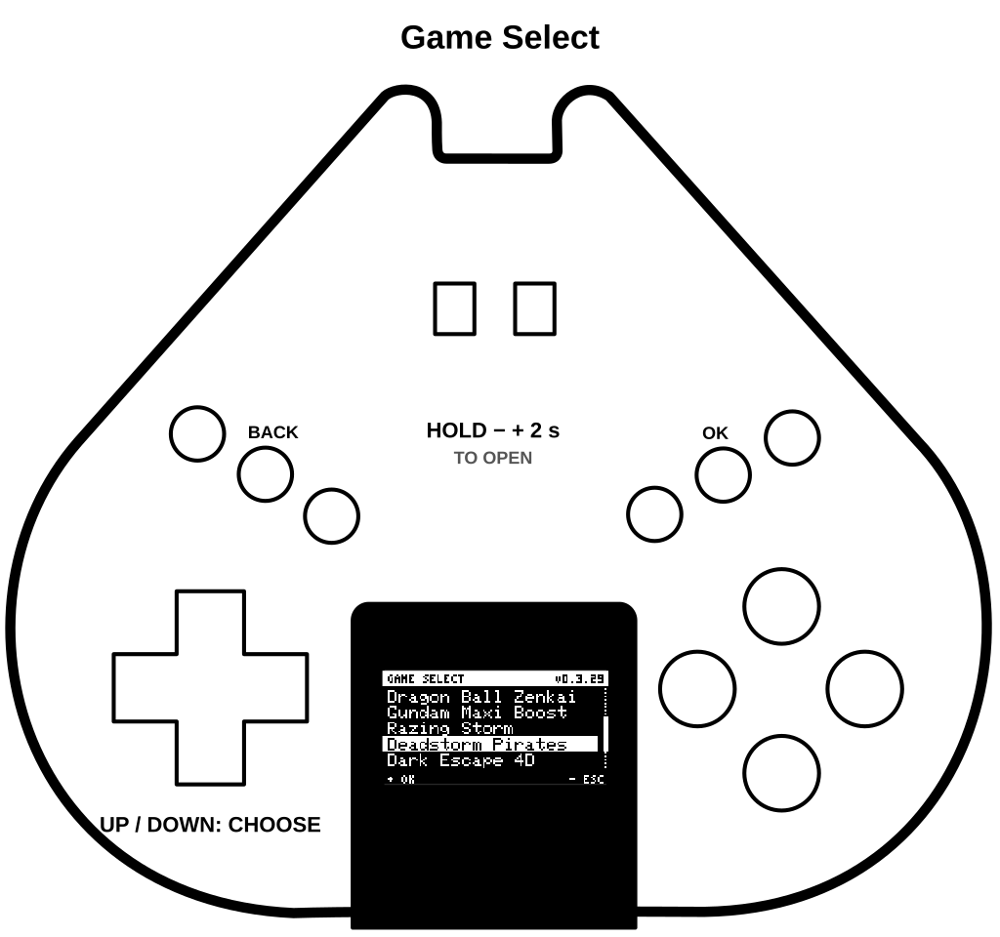
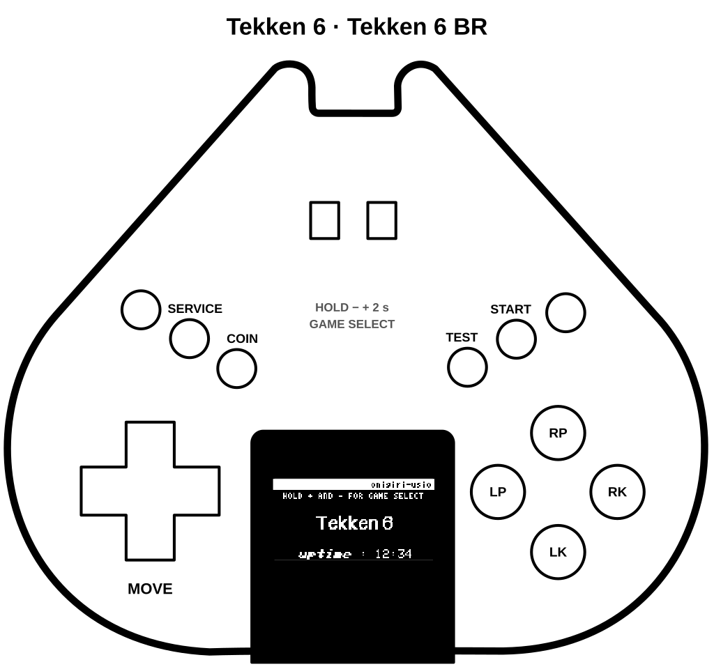
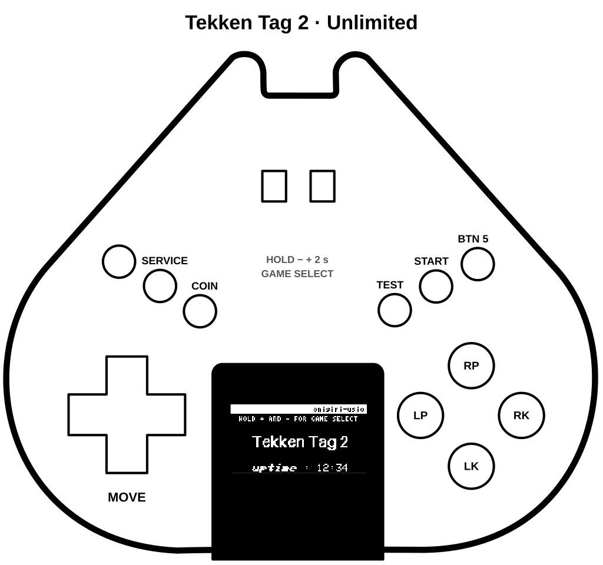
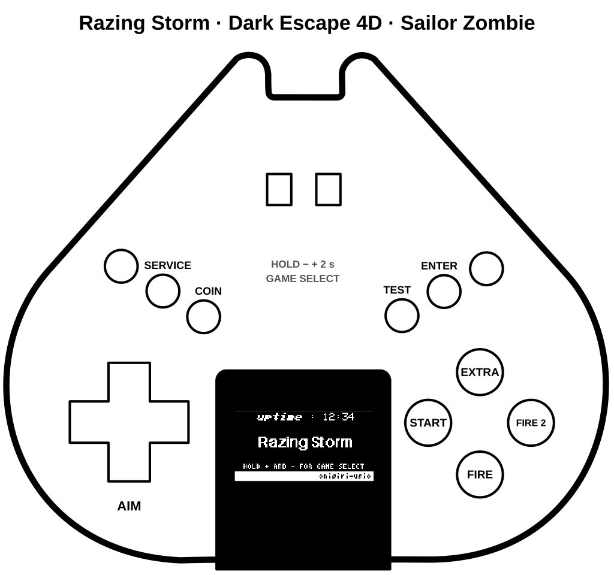
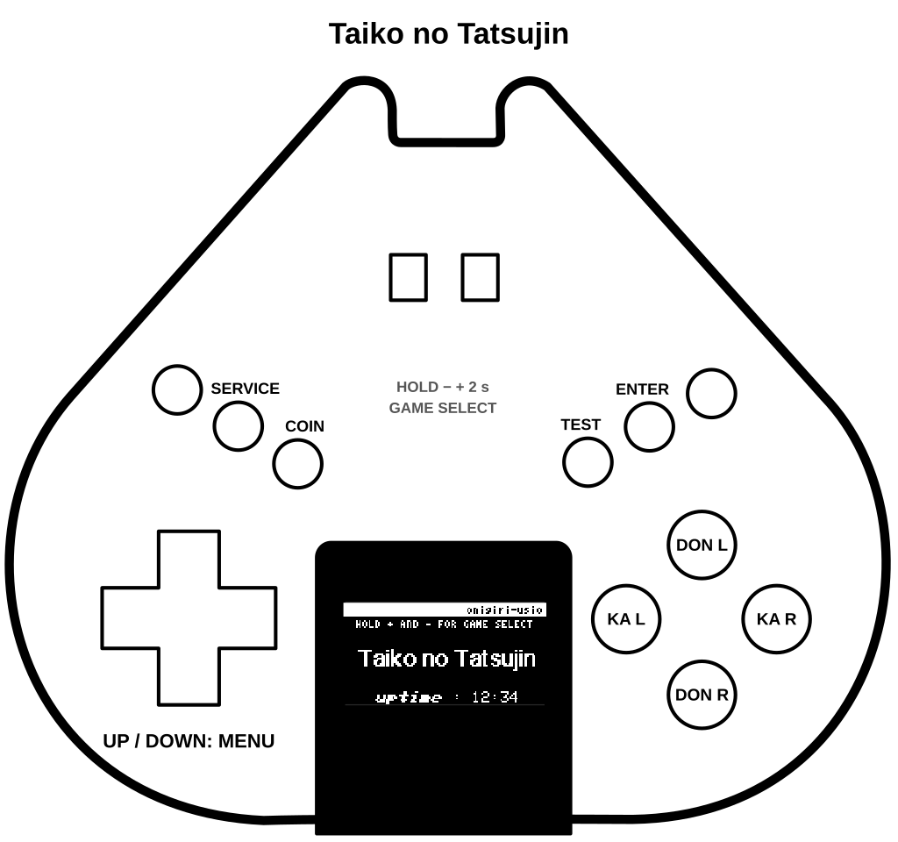
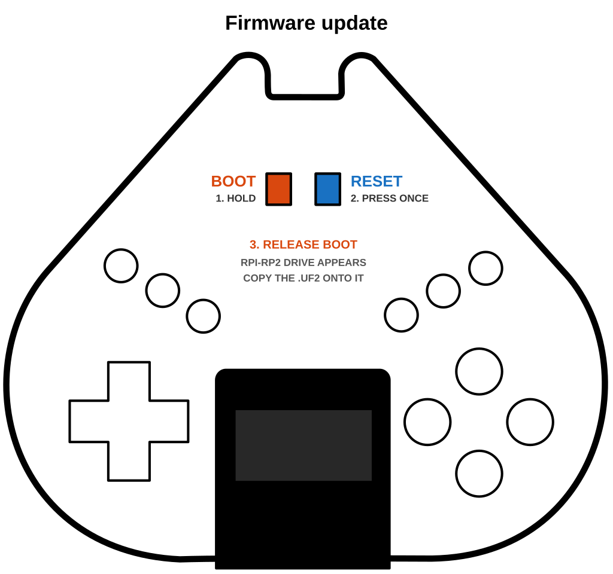

# Onigiri USIO - User manual

## Quick start

1. Connect the Onigiri USB cable to the USB I/O port of the Namco System
   357/369, where the original USIO board goes.
2. Hold **−** and **+** together for 2 seconds. Game Select opens.
3. Choose the game with the D-pad (up/down), confirm with **+**. Press **−** to
   go back without changing.
4. Start the game. The Onigiri remembers the choice; you only select again
   when you change game.

## Display

* **uptime**: time since power on. If the game stops talking to the I/O
  board (crash or freeze), the clock stops and blinks.
* **Game title** in the middle. **DX** appears under Deadstorm Pirates when
  the DX cabinet mode is on.
* **TEST** in the bottom bar while test mode is on.

## System buttons (all games)

| Button | Function |
|---|---|
| **Share** | Coin - one credit per press |
| **Home** | Test mode on / off |
| **−** | Service |
| **+** | Start / Enter in menus |
| **− and +** (2 s) | Game Select |
| **L** | Deadstorm Pirates: DX cabinet on / off (remembered) |
| **R** | Button 5 in Tekken Tag 2, Dragon Ball, Gundam |

## Game controls

### Tekken 6 · Tekken 6 BR

| Button | Function |
|---|---|
| D-pad | Move |
| West / North | Left punch (LP) / Right punch (RP) |
| South / East | Left kick (LK) / Right kick (RK) |
| + | Start |

### Tekken Tag 2 · Tekken Tag 2 Unlimited

| Button | Function |
|---|---|
| D-pad | Move |
| West / North | LP / RP |
| South / East | LK / RK |
| R | Button 5 |
| + | Start |

### Dragon Ball Zenkai · Gundam Maxi Boost

| Button | Function |
|---|---|
| D-pad | Move |
| West, North, South, East | Cabinet buttons 1, 2, 3, 4 |
| R | Cabinet button 5 |
| + | Start |

### Razing Storm · Dark Escape 4D · Sailor Zombie AKB48

| Button | Function |
|---|---|
| D-pad | Aim (hold to move faster); Up/Down in menus |
| South | Fire |
| East | Fire (second trigger) |
| West | Start |
| North | Extra button |
| + | Enter in menus |

### Deadstorm Pirates

| Button | Function |
|---|---|
| D-pad | Aim (hold to move faster); Up/Down in menus |
| South / East | Fire |
| West | Start |
| North | Extra button |
| L | DX cabinet mode on / off |
| + | Enter in menus |

Calibrate the gun in the game's test menu if the crosshair is off center.

### Taiko no Tatsujin

| Button | Function |
|---|---|
| West / East | Ka (rim) left / right |
| North / South | Don (center) left / right |
| D-pad Up / Down | Menu |
| + | Enter |

## Updating the firmware

1. Download the latest `Onigiri-USIO-2MB-vX.Y.Z.uf2` from the
   [Releases](https://github.com/danstronics/onigiri-usio/releases) page.
2. Connect the Onigiri to a computer with the USB cable.
3. Hold **BOOT** (the small button on the left of the top notch), press
   **RESET** (the one on the right) once, then release **BOOT**.
4. A drive called **RPI-RP2** appears. Copy the `.uf2` file onto it.
5. The Onigiri restarts with the new firmware by itself. The selected game and
   the DX setting are kept.

---

Controller drawing: ITAIKO project. Diagrams generated by `tools/gen_manual.py`.
